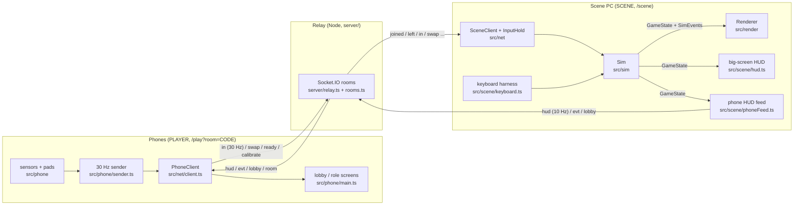

# Gondola Royale: architecture

How the code is put together, what talks to what, and where each track plugs in.
`SPEC.md` says what the game is; this file says how the code delivers it.
Read it with `shared/` open: those files are the contracts this page describes.

## 1. Three programs, one repo

| Program | Runs | Owns | Never does |
|---|---|---|---|
| Scene (`/scene`) | Chrome on the projector PC | the simulation, rendering, HUD, the room | read phone sensors |
| Phone (`/play`) | Safari iOS 16+ / Chrome Android | sensors, touch pads, its own screens | render the world |
| Relay (`server/`) | Node on the scene PC (or Render/Railway/Fly) | room codes, routing by player id, rate limits, serving `dist/` | any game logic |

All three are one Vite + TypeScript app. `src/main.ts` routes on `location.pathname` and loads each mode with a dynamic import, so phones never download Three.js (the scene chunk is about 600 kB, the phone chunk about 75 kB with socket.io).

## 2. The loop on the scene PC

`src/scene/main.ts`, every animation frame:

1. `keyboard.update(dt)`: the keyboard harness writes inputs for the focused team.
2. Fixed step: `while (acc >= SIM.dt) sim.step(SIM.dt)`, at most `SIM.maxStepsPerFrame` steps (60 Hz, spiral-of-death guard).
3. `sim.drainEvents()` once; events go to the renderer (VFX, audio) and, through `forwardEvents`, to phones as `evt` cues.
4. `renderer.render(state, events, layout, views, alpha)` with `alpha = acc / SIM.dt`; the renderer lerps `prevPose -> pose`.

Every 100 ms (not per frame): one `Hud` per phone (`buildHuds`), the `Lobby` roster when it changed or a phone joined, rejoined or left (`LobbySync`: a rejoin into the same seat changes nothing but the phone still needs it), the relay `gate` when the phase changed, and the DOM HUD update.

Phone messages arrive asynchronously through `SceneClient`: inputs go through `InputHold.offer` (drops stale `seq`) into `sim.applyInput`; `swap / ready / calibrate / rename` go to `sim.applyMessage`; joins and leaves to `addPlayer / setConnected / removePlayer`.

## 3. The contracts (`shared/`)

Read-only for agents. A change is agreed out loud, made by one person, with `tests/` updated in the same commit.

| File | Holds | Used by |
|---|---|---|
| `config.ts` | every tunable number, team colours, weapon/power tables, tier flags | everyone |
| `state.ts` | `GameState` (plain serialisable data) and `SimEvent` | sim writes; scene, render, feed read |
| `protocol.ts` | every wire message, the Socket.IO event maps, `NET` wire constants, the parsers for untrusted input | server, src/net, src/phone, src/scene |
| `api.ts` | the `Sim` and `Renderer` interfaces, `Layout`, `CameraView` | the seams between tracks |
| `map.ts` | the 50x38 ASCII map, parser, walls, docks, bridges, coordinate rules | sim (walls), render (buildings) |
| `math.ts` | angle helpers, dead zones, smoothing, seeded RNG | everyone |

## 4. Conventions everyone relies on

- **Units and frame.** Metres, seconds, radians. Three.js world frame, Y up, water at y = 0, map origin at the centre, row 0 of the map at negative z. The 2D sim uses `(x, z)`.
- **Yaw.** `yaw = Object3D.rotation.y`. Forward = `(-sin yaw, -cos yaw)`; yaw 0 looks toward -z; positive yaw turns left. A boat mesh built with its bow along -z needs only `rotation.y = yaw`. `dirFromYaw` / `yawFromDir` in `shared/map.ts` are the only conversions. Pilot `steer > 0` means right, so the sim turns by `-steer`.
- **Time.** Only sim time (`state.time`, advanced by `step`). Every timer is a deadline in that clock (`phaseEndsAt`, `respawnAt`, `shieldUntil`), never `Date.now()`, so pause and tests work.
- **State ownership.** Only `src/sim` mutates `GameState`. The renderer and HUD read it. `prevPose` / `prevAimYaw` are set at the start of each step for interpolation.
- **Lost packets cost nothing.** Inputs are volatile at 30 Hz and the sim holds the last one. Anything a lost packet could break travels as a running total: Gunner aim as absolute `yaw` plus epoch `ep` (re-based behind the bow when `ep` changes), fire taps as `fc`, power taps as `uc`. The `AimTracker` in `src/net/inputHold.ts` implements the scene side.
- **Reliable vs volatile.** Phone `in` and per-phone `hud`/`evt` delivery are volatile; everything fanned in to one socket in the same tick (inputs at the relay -> scene, HUD batch scene -> relay) is reliable. The reasoning is in `server/relay.ts` and `docs/research/netcode/final.md` 2.2.
- **Identity.** Phones keep a token in localStorage (`src/net/identity.ts`); the same token rejoins the same slot and pid. The scene keeps its room code and scene token in sessionStorage, so a reload reclaims the room and the relay hands back its players.
- **Feature flags.** Should/Stretch features check `TIERS` in `config.ts`, so a cut is a flag flip.
- **Debug.** Every feature gets a keyboard or debug toggle. In dev builds the scene exposes `window.gr` (`gr.sim.state`, `gr.sim.debug.giveWeapon(0, 'cannon')`, `gr.sim.debug.endPhase()`, `gr.hold`).
- **Crews.** Who holds what goes by the members aboard, not the lobby's team size (teams of 3 are balanced 3 + 2 + 2): without an Engineer (fewer than 3 members, or `TIERS.engineer` off) the Gunner holds the powers and the hull drains on its own (`hasEngineer` / `gunnerHasPowers` in `src/sim/ctx.ts`).

## 5. Module map and status

"Real" means built to stay; "placeholder" means it satisfies the interface so the game runs end to end, and the owning track replaces its internals.

| Path | Track | Status | What it is |
|---|---|---|---|
| `server/relay.ts`, `rooms.ts`, `index.ts` | A | real (netcode research) | Socket.IO relay, room registry, express static + SPA fallback, `/api/health`, `/api/rooms/:code` (exists / full / locked, for the join screen) |
| `src/net/client.ts` | A | real | phone socket: hello, fast reconnect on wake / `pageshow`, half-open detection from HUD silence, halt after kicked / replaced / closed, `sendInput` |
| `src/net/sceneClient.ts` | A | real | scene socket: host/reclaim room, HUD loop, lobby, gate |
| `src/net/inputHold.ts` | A/B | real | seq filter, stale detection, `AimTracker` (aim re-basing, fire/power tap counters) |
| `src/net/identity.ts`, `qr.ts`, `scanner.ts` | A | real | token and nickname, join QR, fallback in-app scanner |
| `src/phone/sensors.ts`, `sensorMath.ts`, `sensorSim.ts`, `pads.ts`, `wake.ts` | A | real (sensors research, 21 tests) | permission flow, steering from gravity, gyro yaw, shake, multi-touch pads, wake lock, desktop simulator (`?sim=1`) |
| `src/phone/sender.ts`, `controller.ts` | A | real | 30 Hz sampler with running totals; wires sensors, pads and sender |
| `src/phone/main.ts`, `screens.ts`, `view.ts`, `phone.css` | A | real | join screen (code probe), lobby, Enable controls; `view.ts` decides the layer (lobby, pads, resume, spectate, rotate, error panel) and the error texts, pure and tested; role pads with wheel / compass / water meter, SUNK and results; team colour, large role name, haptics; status strip and link warning |
| `src/landing/index.ts` | A | real | Player / Big screen choice over the lagoon and the team mooring poles |
| `src/ui/icons.ts`, `src/styles/base.css` | A/B | real | inline SVG icons (roles, weapons, powers, the ferro mark) and the shared look: lagoon and stone tokens, sign-plate buttons, team pole stripes, self-hosted fonts (Barlow Condensed, Bodoni Moda) |
| `src/sim/index.ts` | B | real | `Sim`: step order, crew inputs, phase clock with sudden death, debug hooks; `createSim` is async (Rapier init) |
| `src/sim/physics.ts`, `walls.ts`, `boat.ts`, `geom.ts` | B | real (physics research) | Rapier 2D world (sim.y = -world.z, angle = yaw), walls from `map.walls`, hull forces, keel, drift, ram detection |
| `src/sim/roster.ts`, `rules.ts`, `items.ts`, `weapons.ts`, `bot.ts`, `tuning.ts`, `ctx.ts` | B | real (rules research) | roster (bot teams closed to phones, keyboard and bot seats never rebalanced); hits, kills, respawn docks, ranking; crates, powers, mines; shots, Water Cannon stream, aim assist and locks; bots on a grid path; sim-only tunables (incl. the steering multiplier); shared crew helpers |
| `src/scene/main.ts` | B | real | wiring and the fixed-step loop |
| `src/scene/layout.ts` | B | real | split-screen rects for 1 to 6 teams |
| `src/scene/keyboard.ts` | B | real | every role from the keyboard, keyboard crews, bot teams |
| `src/scene/hud.ts`, `scene.css` | B | real | lobby with QR, roster, host buttons and kick; timer, scoreboard, kill feed, minimap; per viewport weapon/ammo, powers, water bar, bow arrow, protection and Shield timers, crosshair states, Shield flash, SUNK and kill-cam; results with top Gunner and best ram |
| `src/scene/phoneFeed.ts` | B | real | `Hud` per phone, `SimEvent` -> `Evt` (fired, hit, sunk, kill, shielded, respawn, pickup, power, rammed, countdown, start, win), `LobbySync` |
| `src/scene/views.ts` | B | real | `CameraView` per team: kill-cam on the killer, ended for good if the killer sinks meanwhile |
| `src/render/index.ts` | C | placeholder | `Renderer`: scissor viewports and camera rigs are real; buildings are blocks, water is flat, boats are boxes; carries the crew avatars |
| `src/render/avatars.ts` | C | real | `CrewAvatars`: the people aboard, built from each player's pick (look sheet + cartoon face decal), Pilot standing at the stern with the oar, Gunner at the bow cannon turning with the aim, Engineer amidships with the bucket; spring sway from turns and acceleration, rowing, bailing, sinking and cheering. Boat frame: bow at -Z, deck at y = 0 |
| `shared/characters.ts`, `public/assets/players/` | all | real | the 14 Via Falchi players and the gondolier: names, look sheets, face crops, portraits (512 px for the 3D face, 256 px for phones) |
| `src/phone/picker.ts` | A | real | "Choose your player" after the QR scan; one person per player, the gondolier for anyone; the pick travels as the `character` control message |

## 6. Where each track plugs in

- Task lists per module: `docs/TASKS.md`.
- **Track B** replaces the inside of `src/sim/index.ts` with the Rapier model and rules from `docs/research/physics/final.md` and `docs/research/rules/final.md`, keeping the `Sim` interface. Split it into files (`physics.ts`, `boat.ts`, `teams.ts`, `rules.ts`, `items.ts`, `projectiles.ts`, `aim.ts`) as the research did. `tests/baseline.test.ts` must keep passing.
- **Track C** replaces `src/render/index.ts` with the research renderer in `docs/research/render/code` behind the `Renderer` interface. That code has its own state slice and yaw convention (research yaw = -PI/2 - repo yaw), so write one adapter function `GameState -> RenderState` at the boundary instead of changing either side.
- **Track A** polishes `src/phone/main.ts` into the real screens (wheel graphic, Gunner compass, Engineer meter, sunk and results screens, team-colour background) from the `Hud` it already receives, and owns the tunnel and backup host.

Imports across folders are fine (the sim uses `AimTracker` from `src/net`); edits stay inside your own folders.

## 7. Settled decisions

These are fixed unless the team agrees otherwise out loud.

1. One repo, one Vite app, three routes; dynamic import per route.
2. Coordinates and yaw as in section 4 (`shared/map.ts` is the authority; the map research's heading convention is superseded).
3. Relay is dumb: routes by room code and pid, validates shape, never reads game fields. Protocol version 1, checked at connect.
4. Wire protocol: the netcode research's transport (absolute aim + epoch, tap counters, per-player HUD) with the repo's game payloads. Room codes: 4 letters, pronounceable consonant-vowel pairs, alphabet without I, L, O, Q.
5. Rooms: the relay keeps a room 90 s after its scene drops; a phone slot survives 10 minutes of disconnect.
6. Teams: ordered member list, role = index (Pilot, Gunner, Engineer); `min(6, ceil(n / size))` teams with balanced sizes; most recent joiners move first; beyond 18 players = spectators.
7. Boat: 400 kg; keep `thrust = mass * linearDamping * topSpeed` (2600 N for 10 m/s). The physics research used 1000 kg; scale its forces by 0.4.
8. Sudden death adds `BoatStatus 'out'` for teams that are not tied.
9. Rendering: one `WebGLRenderer`, scissor viewports, one shadow pass per frame, DPR 1, no planar reflections, DOM overlays for the HUD.
10. Match flow: lobby -> countdown 10 s -> battle 300 s -> (sudden death 30 s) -> results 20 s -> lobby. Rematch keeps the teams.
11. Steering stays at zero until the Pilot taps CALIBRATE (during the countdown or in the lobby).
12. Dev ports: Vite 5173, relay `RELAY_PORT` (default 3000). The relay honours `PORT` only in production.

## 8. Testing

| How | What it covers |
|---|---|
| `npm test` | contracts (map, math), relay and rooms (real sockets), sensor math and sender, phone screen logic (`tests/phone.test.ts`), sim/layout/feed |
| `npm run check` | typecheck (browser and server configs), tests, production build. CI runs the same |
| Keyboard harness on `/scene` | K adds a keyboard crew, O a bot team, Enter starts; WASD, arrows, Space, R, Q/E |
| `/play?room=CODE&sim=1` on a desktop | the full phone pipeline with simulated sensors (A/D tilt, arrows turn, Space shake) |
| `npm run tunnel` + a real phone | Gate 1: HTTPS, motion permission, steering on the big screen |
