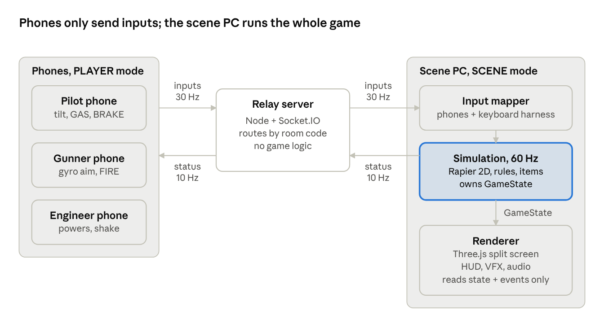
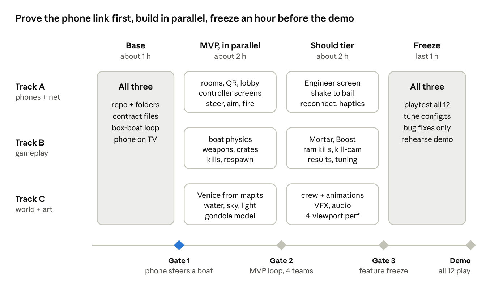

# Gondola Royale: Game Spec & Hackathon Plan

Oct 16, 2026 · @Mex

## The pitch

Gondola Royale (working title) is a party deathmatch for 4 to 18 people in one room. Teams crew armed gondolas in a 3D Venice shown on one big screen, and their phones are the controllers. One hit sinks a boat, a sunk boat is back in 5 seconds, and after 5 minutes the team with the most kills wins.

The core loop, in one 5-minute match:

1.  Each team spawns at a random dock with empty hands.

2.  Teams race to floating crates for weapons and powers, like the pickups in Blur. Every weapon has only a few shots (5 by default), so the looting never stops.

3.  Teams hunt in the wide canals or ambush from the narrow side canals.

4.  One hit sinks a boat. The shooter's team scores a kill; the sunk team takes a death.

5.  Five seconds later the sunk boat respawns at a random dock with nothing. At 5:00 the team with the most kills wins.

Design rules we hold ourselves to:

- **Nobody is a passenger.** Every role has something to do every second.

- **The big screen tells the story.** Anyone in the room can follow who is winning at a glance.

- **Zero friction.** Scan, tap, play in under 30 seconds. No install, no account.

- **Death is short, never final.** A sunk crew is back in 5 seconds, so nobody stands around watching.

What changes from the Regata Storica concept: racing is gone. We keep phones as controllers, the big screen, QR join and the HTTPS motion-sensor lesson. The Doge in VR and the printed trophy move to stretch goals.

## 1. Platform rules

One web app, one URL, two modes. Nothing gets installed anywhere.

| Mode | Runs on | Does | Never does |
|----|----|----|----|
| SCENE | The PC wired to the projector, opened once | Runs the whole game: simulation, physics, 3D rendering, split screen, audio. It is the single source of truth. | Read phone sensors |
| PLAYER | Every phone | Reads touch and motion sensors, sends inputs, shows a control pad plus status (role, ammo, team score, respawn countdown) | Render the game world or any 3D |
| Relay server | A small Node process | Routes messages between phones and the scene by room code | Game logic of any kind |

Hard requirements:

- **HTTPS everywhere.** iOS only grants motion sensors and the camera on secure pages, and only after a user tap.

- **Browsers:** Safari on iOS 16+ and Chrome on Android for phones. Chrome on the scene PC.

- **Phone orientation:** landscape for Pilot and Gunner. Show a "rotate your phone" overlay otherwise, since iOS ignores orientation lock.

- **Scene PC:** a laptop or PC with a dedicated GPU, 1080p output to the projector.

- **Keyboard fallback:** every role can be played from the scene PC keyboard. This is both the dev test harness and the backup if a phone fails mid-demo.

## 2. Joining, teams and the split screen

Players join by scanning a QR with the phone's normal camera, which drops them straight into the lobby. One change from the original idea: the QR carries the room link, so phones don't need an in-app scanner.

1.  On the projector PC, open the app and pick **SCENE**. It creates a room with a 4-letter code (for example RIVA) and shows a large QR, the code and a short URL.

2.  Players scan the QR with the phone camera. The QR encodes https://\<host\>/play?room=RIVA, so the phone opens directly in PLAYER mode inside that room.

    - The **PLAYER** button on the landing page stays as a fallback. It opens an in-app QR scanner plus a field to type the 4-letter code.

    - Why the change: an in-app scanner adds a camera permission prompt and a library. The native camera skips both.

3.  The phone shows a random Venetian nickname (editable) and one big **Enable controls** button. That single tap is required: it triggers the iOS motion permission and the screen wake lock.

4.  The player appears on the big screen, slotted into a team and a role.

5.  The host starts the round from the scene PC (Start button or Space bar).

**Team assignment**

- The host picks team size in the lobby: 3 (default) or 2. Twelve people in teams of 3 gives 4 teams and a clean 2×2 screen.

- Players fill teams in join order. Inside a team, roles fill in order: Pilot, then Gunner, then Engineer.

- Until the round starts, a player can swap role with a teammate or move to any team with a free slot, from the phone.

- Maximum 6 teams, because that is the most viewports a projector can show readably.

- Odd counts are balanced, not left over: 7 players in teams of 3 becomes 3 + 2 + 2, never 3 + 3 + 1.

Short-handed teams merge roles automatically:

| Members | Who does what |
|----|----|
| 3 | Pilot, Gunner, Engineer |
| 2 | Pilot. The Gunner also gets the two power buttons. Bailing water happens automatically at half speed. |
| 1 (stretch) | Solo controller: tilt to steer with auto-throttle, one FIRE button that auto-targets the nearest enemy ahead |

**Split-screen layouts** on a 16:9 screen, fixed for the whole round so people don't lose track of their view:

| Teams | Layout                  | Spare cell                              |
|-------|-------------------------|-----------------------------------------|
| 2     | Two side-by-side halves | None                                    |
| 3     | 2×2 grid                | Live overview map                       |
| 4     | 2×2 grid                | None, minimap sits where the cells meet |
| 5     | 3×2 grid                | Live overview map                       |
| 6     | 3×2 grid                | None, minimap sits where the cells meet |

Each viewport has a thick border in the team colour and the team name. Team colours: Rosso, Azzurro, Verde, Oro, Viola, Arancio. When a boat sinks, its cell shows a 5 s kill-cam on the boat that sank it, with a countdown, then cuts back to the respawned boat.

## 3. Roles and phone controls

One boat per team, one job per player. The third role (Engineer) is our addition so teams of 3 have a real job, not a spectator seat.

### Pilot: drives the boat

On screen: the gondolier standing at the stern with the oar.

- Hold the phone in landscape with both hands, like a steering wheel. Rotate it left or right to steer. Dead zone of 4°, full lock at 35°.

- Right thumb holds **GAS** (the whole right half of the screen). Left thumb holds **BRAKE / REVERSE** (the left half).

- Hold BRAKE while steering at speed for a **drift turn**: sharper turn, loses speed.

- **Ramming:** hitting an enemy at high speed while boosted sinks them. This gives the Pilot an attack of their own.

- **Calibration:** during the countdown the Pilot holds the phone in a comfortable position and taps CALIBRATE. That angle becomes "straight".

- Phone shows a big steering-wheel graphic that rotates live with the tilt. This feedback is essential, since the Pilot is looking at the wall, not the phone.

### Gunner: aims with the gyroscope and shoots

On screen: seated mid-boat behind a swivel cannon that turns with the aim.

- Hold the phone in landscape with both hands, like a camera, and turn it left or right to turn the view and the cannon. **Gyroscope only:** no dragging, no looking up or down. Full rules in section 4.

- **FIRE:** the whole right two-thirds of the screen is one big button. Tap to fire, hold for auto-fire where the weapon allows it.

- **RECENTER:** a smaller button on the left that snaps the view back behind the bow.

- **Calibration:** during the countdown, point the phone at the big screen and tap CALIBRATE. That direction becomes "straight ahead along the bow".

- Phone shows the current weapon, ammo left, a flash when a shot lands, and a small compass needle showing aim against the bow.

### Engineer: powers and damage control

On screen: seated at the bow with a bucket.

- Two power slots shown as two huge buttons. Tap to use (Shield, Boost, Mine, Smoke).

- **Bailing:** Water Cannon hits fill the hull, and a full hull halves the boat's speed. When there is water aboard the phone shows SHAKE TO BAIL and a water meter. Shaking empties it, and the character bails with the bucket on the big screen.

- Stretch: **Ping** reveals every enemy on the minimap for 2 s, then a 20 s cooldown.

- Portrait or landscape, either works.

### Rules for every controller

- Phones send input 30 times per second, not on every sensor event.

- Android vibrates on fire and on hit. iOS Safari has no vibration API, so iOS flashes the screen red instead.

- The screen wake lock keeps phones awake for the whole round.

- The phone background is the team colour with the role name in large type, so people can check at a glance.

## 4. Camera, aiming and the target pointer

Each team's viewport is a third-person camera on its own boat, turned left and right by the Gunner physically turning the phone. The crosshair never moves: it is fixed at the centre of the view, and every shot travels flat along the water. Aiming is left and right only.

**Gunner aim (gyroscope only)**

- Turning the phone left or right turns the view and the cannon. No dragging, no up or down.

- **Gain of 2:** turning the phone 45° turns the view 90°, so a quarter turn of the body covers everything behind the boat. Nobody has to spin around in a crowded room.

- **Stabilised aim:** the aim direction is held in the world, not on the boat. When the Pilot turns, the Gunner's view does not swing with the boat, so a target under the crosshair stays there.

- **Reset:** RECENTER snaps the view behind the bow and clears gyro drift. The view also resets behind the bow at calibration and at every respawn.

- A small dead zone (about 2° per second) ignores hand tremor.

**Camera**

- Sits about 9 m behind and 4 m above the boat, along the aim direction. It looks level, so the horizon runs through the centre of the view and the boat sits in the lower part of the frame.

- Steering is always boat-relative: tilt left and the boat turns left, whatever the camera faces.

- A small arrow at the bottom of the viewport shows the bow against the aim direction, so the Pilot is never confused when the Gunner looks sideways.

**Target pointer (crosshair)**

- One crosshair per viewport in the team colour, fixed at the centre of the view on the horizon line. It never moves on screen.

- Every shot leaves the cannon at hull height and travels flat along the aim direction. All boats sit at the same level, so there is nothing to aim up or down at.

- In code, aim is just an angle in the 2D top-down simulation: hits are 2D rays and 2D projectile checks. Simpler and cheaper than 3D aiming.

- States: neutral ring; red diamond when an enemy is on the aim line; X flash on a hit; a lock-on ring when a Torpedo is ready and an enemy is in range.

- The Mortar needs no up or down either: it auto-ranges onto the nearest enemy near the aim line (section 6).

**Aim assist is required.** Gyro aiming while watching a wall is less precise than a mouse. Cannon shots bend up to 4° toward the nearest enemy near the aim line, and the gyro gain drops by 40% while an enemy is under the crosshair. Both values live in the tuning config.

## 5. Match rules

One mode for the hackathon: **Five-Minute Deathmatch**. One hit sinks a boat, sunk boats respawn after 5 s with nothing, and the team with the most kills at 5:00 wins.

**Kills and deaths**

- Any lethal hit sinks the boat instantly: Cannon, Torpedo, Mortar, Mine, or a boosted ram.

- The team that fired scores +1 kill and the sunk team takes +1 death. A Mine credits the team that dropped it.

- Your own shots, splash and Mines never hurt you.

- The Water Cannon never kills. It pushes boats and fills their hull.

- A Shield absorbs one lethal hit. It is the only way to survive a hit.

**Death and respawn**

- On a lethal hit the boat flips and sinks (about 2 s) and the crew tumbles into the canal.

- For 5 s the team's viewport shows a kill-cam on the boat that sank it, with "SUNK by Azzurro" and a countdown. Phones show the same countdown.

- After 5 s the boat respawns at a random dock with nothing: no weapon, no powers, an empty hull.

- The dock is picked at random among the ones at least 80 m from every enemy boat (about 16 docks around the map), so nobody respawns into a fight.

- 3 s of spawn protection, shown as a bubble. It ends early if the Gunner fires, so it can't be abused to attack.

**Hull water.** Water Cannon hits add water to the hull, from 0 to 100. Speed is multiplied by 1 - 0.5 × water / 100, so a full hull halves speed. The Engineer shakes it out; 2-person teams drain automatically at half speed. Slow boats are easy targets, so the Water Cannon sets up kills without making them.

**Scoring and winning.** A live scoreboard sits on the big screen all match.

| Order | Rule |
|----|----|
| 1\. Kills | Most kills at 5:00 wins |
| 2\. Deaths | Tied on kills: fewer deaths wins |
| 3\. Sudden death | Still tied: 30 s overtime between the tied teams, next kill wins |

Why kills first rather than kills minus deaths: a net score rewards hiding in a side canal all match, which is dull to play and to watch. Ranking by kills keeps everyone hunting; deaths only break ties.

**Round flow**

| Phase | Length | What happens |
|----|----|----|
| Lobby | Until host starts | Join, teams, roles, Enable controls |
| Countdown | 10 s | Boats shown at their spawn docks with crew names, Pilots and Gunners calibrate, 3-2-1 horn |
| Battle | 5:00, fixed | Loot, fight, sink, respawn |
| Results | 20 s | Final scoreboard (kills and deaths per team), top Gunner, best ram, podium with the winning crew, Rematch (same teams) or New lobby |

The closing fog zone from the first draft is gone: it exists to end a battle royale and has no job in a timed match. Stretch idea in its place: in the final 60 s crates respawn twice as fast and the timer turns red.

## 6. Pickups, weapons and powers

Items are scarce and run dry fast, so teams keep moving between crates all match, as in Blur. Wooden crates float at about 24 fixed points, each topped by a glowing lantern whose colour tells the category. Drive through a crate to collect it; it respawns 8 s later with random contents from its category.

| Crate colour | Category | Goes to                         |
|--------------|----------|---------------------------------|
| Red          | Weapon   | Gunner                          |
| Blue         | Power    | Engineer (Gunner in teams of 2) |

Inventory rules:

- Every life starts empty. Death wipes the weapon slot and both power slots.

- The Gunner always has the non-lethal Water Cannon plus one weapon slot. Picking up the same weapon tops its ammo back up; a different weapon replaces the old one.

- When the last shot is fired, the slot empties and the Water Cannon is back automatically. No switch button needed.

- The Engineer holds 2 powers. With both slots full, a blue crate is left in the water for someone else.

| Item | Kind | Ammo or duration | Effect | Tier |
|----|----|----|----|----|
| Water Cannon | Default, non-lethal | Infinite | Short-range stream. Pushes boats and fills their hull. Never kills. | MVP |
| Cannon | Weapon | 5 shots | Fast straight shot with mild aim assist. Sinks on hit. | MVP |
| Torpedo (Siluro) | Weapon | 2 shots | Locks the nearest enemy in a 40° cone ahead and homes along the water. Sinks on hit. | MVP |
| Fireworks Mortar (Fuochi del Redentore) | Weapon | 3 shots | Auto-ranged lob: lands on the nearest enemy within 10° of the aim line and 60 m, even behind buildings; with no target it lands 40 m ahead. 6 m splash, sinks on hit. | Should |
| Shield | Power | 8 s or 1 hit | Bubble that absorbs one lethal hit. | MVP |
| Mine | Power | 1, lasts 45 s | Dropped behind the boat, arms after 1 s, sinks the first enemy that touches it. | MVP |
| Boost | Power | 3 s | +60% speed. A ram during boost sinks the target. | Should |
| Smoke (Nebbiolina) | Power | 6 s | Smoke trail that hides you and breaks Torpedo locks. | Stretch |
| Wave (Onda) | Power | 1 use | Shoves every boat within 12 m away, for example into your Mine. | Stretch |

**Ammo.** Five shots is the baseline. Homing and splash weapons get fewer (Torpedo 2, Mortar 3), because with one-hit kills they would otherwise decide every fight. All numbers live in the tuning file and get adjusted at the playtest.

**Counters**, so no item is a free win: the Torpedo is our version of the Blur Shunt, and Shield, Mine and Smoke answer it. The Mortar answers hiding in side canals.

## 7. The map: one Venetian district

One compact, invented district that reads as Venice at a glance: about 400 m × 300 m, crossable in roughly 40 s at full speed. It is inspired by Venice, not a copy of real streets, so we can design it for fights.

**Layout**

- **Main canal:** a wide S-shaped canal (Canal Grande style, about 30 m wide) cutting across the map. The open fighting lane.

- **Side canals (rii):** a grid of about 8 narrow canals, 8 to 10 m wide, with tight bends and a few dead ends. One gondola fits easily, two scrape. Ambush territory.

- **Lagoon basin (bacino):** open water along one edge. Big open fights, and the densest cluster of crates, so it pulls teams into fights.

- **Bridges:** 6 to 8 arched stone bridges plus one large covered bridge at the centre as the main landmark (Rialto style). Boats pass under every bridge.

- **Bell tower (campanile):** tall enough to be seen from every viewport, for orientation.

- **Obstacles:** striped mooring poles along walls, a few moored gondolas, wooden pile clusters in the lagoon.

**Hiding.** Buildings hide boats in side canals from other viewports naturally. The shared minimap shows an enemy only for 2 s after it fires, or while it is in the open lagoon. Hiding is countered by the Mortar, which lobs over walls, and by the scoring: a team that hides scores no kills.

**How the map is built.** The whole map is one ASCII grid in shared/map.ts, 8 m per cell, about 50 × 38 cells. Physics builds its walls from the grid, and the renderer builds the buildings from the same grid. This single file is what lets the gameplay and art tracks work in parallel without waiting on each other.

\# Legend: B building ~ water = bridge over water (visual only)\
\# L lagoon S spawn dock C crate point T landmark tower\
BBBBBBBBBBBBBBBBBBBBBBBB\
BBB\~~BBBBB\~~BBBBBBBBC~LL\
BBB\~~BBBBB\~~BBBBB\~\~\~\~~LL\
\~\~\~\~\~\~\~~=\~\~\~\~\~\~\~\~\~\~\~\~~LL\
\~\~~S\~\~\~~=\~\~\~~C\~\~\~\~\~\~~SLL\
BBB\~~BBBBBBBBB\~~BBBB\~~LL\
BBB==BBBTBBBBB\~~BBBB\~~LL\
BBB\~~BBBBBBBBB\~~BBBB\~~LL

Coordinates: metres, Y up, water surface at y = 0, map origin at the centre. The 2D physics uses (x, z) of the 3D world.

## 8. Physics

Gameplay physics runs in 2D on the water plane, and everything is drawn in 3D. Boats never leave the water, so a 2D solver gives correct collisions with far less code and far fewer bugs. This is the biggest time-saver in the spec.

- **Engine:** Rapier 2D (WASM build) for boats, walls, poles, crates and mines.

- **Projectiles:** small custom code (position, velocity, gravity) with distance checks against boats. Cannonballs and mortar shells arc in 3D; only their impact point matters for hits.

- **Timestep:** fixed 60 Hz simulation; the renderer interpolates between steps.

**Boat handling (arcade, all values tunable)**

- Rigid body shaped like a gondola, about 6 m × 1.4 m.

- GAS pushes forward; reverse is 40% of forward thrust.

- Strong sideways drag (the keel), so the boat goes where it points. Sideways drag drops during a drift turn, so the stern slides out.

- Linear and angular damping act as water resistance. Steering strength grows with speed, with a slow turn still possible at rest.

- Top speed about 10 m/s (roughly 3× a real gondola, for fun), 16 m/s with Boost.

**Visual-only motion** (costs nothing in the simulation): boats bob on the waves, roll up to 8° into turns, pitch when accelerating and sit lower when the hull holds water.

**Collisions and forces**

- Boat against wall: bounce and scrape sparks, no damage.

- Boat against boat: both bounce with real momentum exchange. A boosted ram sinks the target; two boosted boats just bounce.

- A lethal hit applies an impulse at the impact point, so the boat flips and spins as it sinks. A hit absorbed by a Shield causes a spin-out instead.

- The Water Cannon applies a continuous push along its stream.

- Crates and mines are light bodies that drift and can be shoved around.

- Other boats crossing a wake rock visibly.

**Crew physics.** Characters are animated and lean against turns, jolt on hits and sway with the boat. When a boat sinks, each character gets an impulse and tumbles into the water with a splash.

## 9. Graphics, characters and audio

The target is convincing Venice at projector distance, at 60 fps with 4 viewports. Realism comes from light, water and materials far more than from polygon count.

**Look**

- **Light:** golden hour. A warm HDRI sky (Poly Haven, free CC0), a low sun, soft haze in the distance.

- **Water:** dark green-teal with animated normal maps, sky reflection and foam behind moving boats. No mirror-style planar reflections: they double the render cost of every viewport.

- **Buildings** (generated from the map grid): 3 to 5 floors; plaster in ochre, terracotta, rose and cream; white Istrian stone around windows and along the waterline; gothic arched windows; green shutters; small balconies; funnel-shaped chimneys; a dark algae band at the waterline; laundry lines across some side canals.

- **Props:** striped mooring poles, arched stone bridges with railings, wall lanterns, flower boxes, moored boats.

**Boats and crew**

- **Gondola:** long, black, slightly asymmetric hull with the iron bow piece (ferro), trim in the team colour, and one tall lantern at the bow glowing in the team colour, so every boat is identifiable across the map.

- **Crew:** striped shirts and straw hats with a team-coloured ribbon. The Pilot stands at the stern rowing, faster while GAS is held. The Gunner sits at the swivel cannon and turns with it. The Engineer sits at the bow with a bucket.

- **Animations needed:** row, sit idle, aim-turn, bail, flinch on hit, fall overboard, celebrate.

- **Source:** Mixamo characters and animations (free) exported as GLB. If importing eats too much time, use simple stylised characters generated in code with Fable 5.1. Decide this in the first hour, not later.

**Effects:** muzzle flash and smoke, cannonball splash, explosion with a water column, a boat flipping and sinking, wake foam, the spawn-protection bubble, a respawn splash, firework bursts for the Mortar and the podium.

**Audio** (scene PC only, phones stay silent): lapping water, distant bells, seagulls, cannon booms, splashes, a short accordion or mandolin loop in the lobby, a horn at round start.

**Performance rules**

- Share geometry and materials; use instancing for windows, poles and lanterns; merge building meshes per block.

- Render the shadow map once per frame, not once per viewport.

- Let the haze hide the far edge; simplify buildings beyond about 120 m.

- Measure with 4 viewports by the second checkpoint, not at the end.

## 10. Screens: big-screen HUD and phone UIs

The big screen carries all game information; phones carry only what a player needs to act without looking down for long.

**Inside each team viewport**

| Position | Shows |
|----|----|
| Top left | Team name and crew names with role icons |
| Top right | Team kills and deaths |
| Centre | Crosshair in the team colour |
| Bottom left | Weapon icon and ammo |
| Bottom right | The Engineer's 2 power slots and the hull water bar |
| Bottom centre | Bow-vs-camera arrow; spawn-protection timer after a respawn |
| Full frame | Blue flash when a Shield absorbs a hit; on death, the 5 s kill-cam with SUNK by and the countdown |

**Shared across the whole screen**

- Top centre: round timer and the live scoreboard, kills per team in team colours.

- Kill feed under it, for example "Azzurro sank Verde with a Torpedo".

- Minimap (spare grid cell, or centre where the cells meet): crates and enemy boats only while revealed.

**Phone screens**

| Screen | Contents |
|----|----|
| Landing | Two big buttons, SCENE and PLAYER. On a phone, PLAYER is the highlighted one. |
| Join (fallback only) | In-app QR scanner and a 4-letter code field |
| Lobby | Nickname, team colour, role, Swap role, Enable controls, Ready |
| Pilot | Steering wheel graphic rotating with the tilt, GAS on the right half, BRAKE on the left half, team kills |
| Gunner | FIRE over the right two-thirds, RECENTER on the left, weapon and ammo, compass needle for aim against bow. No aim pad: aiming is the gyroscope. |
| Engineer | Two big power buttons, water meter, SHAKE TO BAIL prompt |
| Sunk and Results | Sunk: who sank you and the 5 s countdown. Results: final scoreboard and rematch status |

## 11. Tech stack, architecture and protocol

The scene PC is the game: it simulates, renders and decides everything. Phones send inputs through a small relay and get status back.

runtime architecture · phones, relay, scene PC

Inputs flow right at 30 Hz, status flows back at 10 Hz. The relay never runs game logic, and the renderer never changes game state.

**Stack**

| Part | Choice | Why |
|----|----|----|
| Build | Vite + TypeScript, one repo, one app | Fast dev server; AI agents know it well |
| Routes | / landing, /scene, /play?room=XXXX | Same app, two modes |
| 3D | Three.js, plain (no React in the game loop) | Most examples available; split screen via scissor viewports |
| Physics | Rapier 2D (@dimforge/rapier2d-compat) | Fast WASM solver, simple API |
| Phone UI | Plain TS with HTML and CSS (React optional) | Six small screens, no build complexity |
| Realtime | Node + Socket.IO relay | Rooms and auto-reconnect for free |
| QR | qrcode to generate; qr-scanner for the fallback scanner | Small, no setup |
| Hosting | Relay on the scene PC, exposed with Cloudflare Tunnel (cloudflared tunnel --url http://localhost:3000) or ngrok http 3000 | Instant HTTPS URL for the QR, no deploy step |
| Backup host | Render, Railway or Fly.io | Any host running a long-lived Node process. Serverless functions are a poor fit for a WebSocket relay. |

**Contract files.** Written together in the base phase, then read-only for every agent.

| File | Holds |
|----|----|
| shared/protocol.ts | Every message type below |
| shared/state.ts | The GameState type: the simulation writes it, the renderer and HUD read it |
| shared/map.ts | The ASCII map, legend, parser and coordinate rules |
| shared/config.ts | Every tunable number: speeds, damage, timers, aim assist, ammo, respawn and spawn-protection timers |

**Folder layout** (each folder has one owner, see the plan below)

server/ relay (Node + Socket.IO), also serves the built app\
shared/ contract files\
src/landing/ SCENE / PLAYER choice\
src/net/ socket client, rooms, reconnect\
src/phone/ lobby + Pilot, Gunner, Engineer screens, sensors\
src/sim/ physics, rules, items, kills, respawn, score\
src/scene/ camera rigs, viewports, HUD, keyboard harness\
src/render/ world, water, boats, crew, VFX, audio\
public/assets/ models, textures, sounds

**Messages**

type Role = 'pilot' \| 'gunner' \| 'engineer'\
\
// phone -\> relay -\> scene\
type Hello = { t: 'hello', room: string, token: string, name: string }\
type Swap = { t: 'swap', team?: number, role?: Role }\
type PilotIn = { t: 'in', role: 'pilot', steer: number, gas: boolean, brake: boolean } // steer -1..1\
type GunnerIn = { t: 'in', role: 'gunner', dYaw: number, fire: boolean, recenter: boolean } // dYaw: radians since last packet\
type EngIn = { t: 'in', role: 'engineer', use: 0 \| 1 \| null, shake: number } // shake 0..1\
\
// scene -\> relay -\> phone\
type Hud = { t: 'hud', phase: 'lobby' \| 'countdown' \| 'battle' \| 'results', team: number, role: Role,\
kills: number, deaths: number, respawnIn: number, weapon: string, ammo: number,\
powers: \[string \| null, string \| null\], water: number, alive: boolean }\
type Evt = { t: 'evt', kind: 'kill' \| 'sunk' \| 'respawn' \| 'shielded' \| 'fired' \| 'pickup' \| 'win' }

**Interfaces between tracks**

sim.addPlayer(id, team, role)\
sim.applyInput(id, input) // from phones or the keyboard harness\
sim.step(1 / 60)\
sim.state // GameState, read-only outside src/sim\
sim.drainEvents() // kill, sunk, respawn, fired, pickup, win -\> VFX, audio, phone haptics\
render(state, events, layout) // one camera per team, scissor viewports

**Sensor notes for the phone code**

- **Steering:** compute it from the gravity vector in DeviceMotionEvent.accelerationIncludingGravity (the angle of its x and y components, minus the calibration angle). Avoid the alpha, beta and gamma orientation angles: they jump when the phone is held upright, and alpha drifts. Calibration also absorbs which way the phone is turned.

- **Gunner aim:** read DeviceMotionEvent.rotationRate (the gyroscope, degrees per second) and project it onto the low-pass-filtered gravity vector. That gives the turn rate around the vertical axis however the phone is tilted. Integrate it over time, apply the dead zone and the gain of 2, and send the change as dYaw. Check the sign on the first test and flip it if left turns right. If rotationRate is null (a phone without a gyroscope), fall back to changes in the alpha angle of deviceorientation, which is noisier.

- **Shake:** count peaks where acceleration without gravity exceeds about 15 m/s². More peaks per second means faster bailing.

- **iOS:** DeviceMotionEvent.requestPermission() must run inside a tap handler, on HTTPS. One permission covers both steering and gyro aim.

- **Wake lock:** navigator.wakeLock.request('screen') in the same tap.

- **Reconnect:** keep a token in localStorage; the same token rejoins the same team and role.

## 12. Scope tiers

The full spec is more than a few hours of work, even with three AI agents. Build in tiers, and only start a tier when the previous one is playable end to end. The respawn deathmatch is cheaper to build than the battle royale was: no fog, no lanterns, no elimination spectating.

| Tier | Includes |
|----|----|
| MVP (must demo) | SCENE + QR join + lobby; teams of 2 (Pilot + Gunner), up to 4 teams; 2×2 split screen; tilt steering, gyro aim, FIRE; crates with Cannon, Torpedo, Shield, Mine plus the non-lethal Water Cannon; one-hit kills and sinking; 5 s respawn at a random dock with items wiped; spawn protection; 5:00 timer, live scoreboard, results screen; one Venice map |
| Should | Engineer role and teams of 3, so all 12 of you play; Mortar; Boost and ram kills; kill-cam; animated crew; bailing by shaking; kill feed; audio |
| Stretch | Smoke and Wave; final-minute frenzy; solo teams; the Doge in VR on the Quest 3 as a spectator who drops crates; printed phone grips and a gondola trophy on the Bambu A1 |

**Cut order if you fall behind**, first to go at the top: Wave and Smoke, final-minute frenzy, Mortar, kill-cam (show the countdown over the sinking boat instead), animated crew (use static seated poses), Engineer (teams of 2 only).

**Never cut:** QR join, steering, aiming, the kill and respawn loop, the live scoreboard, the results screen. Those six are the game.

If you want the printed trophy, start the print in the first hour: prints run for hours unattended and can't be rushed at the end.

## 13. The 3-person hackathon plan

Build the shared base together in the first hour, then split into three tracks that own separate folders and merge to main at three gates. The contract files and the keyboard harness mean nobody waits on anyone.

hackathon roadmap · 4 phases, 3 tracks, 3 gates

Durations assume about 6 hours of build time. With less, stop at Gate 2 and polish the MVP.

**Base phase, all three together (about 1 hour)**

- [ ] Create the repo: Vite + TS, the three routes, the Socket.IO relay, the folder layout. Push to GitHub.

- [ ] Write the four contract files: protocol.ts, state.ts, map.ts (a first rough map), config.ts.

- [ ] Placeholder loop: the sim moves box boats on a flat grid from keyboard input, and the renderer draws them in 2 viewports.

- [ ] Start the tunnel and open it on one iPhone: Enable controls, tilt, and a box boat turns on the TV. This is Gate 1, and the riskiest unknown.

- [ ] Commit SPEC.md (this doc, exported to Markdown) and one TASKS.md per track.

- [ ] If you want the printed trophy, start the Bambu A1 print now.

**The three tracks**

| Track | Owns | Delivers by Gate 2 (MVP) | Delivers by Gate 3 (Should) |
|----|----|----|----|
| A. Netcode and phones | server/, src/net/, src/phone/, src/landing/ | Rooms, QR, lobby on both screens, team and role assignment, Pilot and Gunner controllers, steering from gravity, gyro aim, calibration, wake lock | Engineer controller, shake to bail, reconnect into the same slot, haptics and screen flash, HUD feed to phones, backup host |
| B. Gameplay and physics | src/sim/, src/scene/ | Rapier boat model, collisions, Water Cannon, Cannon, Torpedo, Shield, Mine, crates, one-hit kills, sinking, 5 s respawn, spawn protection, scoreboard, camera rigs, crosshair and aim assist, big-screen HUD, keyboard harness for every role | Mortar, Boost and ram kills, kill-cam, kill feed, results screen, tuning pass in config.ts |
| C. World and art | src/render/, public/assets/ | Venice built from map.ts, water, sky and light, gondola with team colours and its team lantern | Crew and animations, VFX, audio, podium, performance pass with 4 viewports |

Who takes what: Track A to whoever knows realtime web and mobile Safari quirks best, Track B to the strongest game-logic coder, Track C to the best visual eye. Fable 5.1 does most of its work on Track C.

**Gates.** At each gate everyone merges to main, plays one round on real phones for 5 minutes, and decides what to cut.

1.  **Gate 1:** one phone steers a box boat on the TV.

2.  **Gate 2:** 4 teams join by QR, loot, shoot, sink, respawn and finish a 5:00 match on the scoreboard, with placeholder art. Measure frame rate with 4 viewports here.

3.  **Gate 3, feature freeze:** real Venice, gondolas and crew in the loop; Should-tier features are in or cut. After this, only bug fixes and tuning.

**Working with your AI agents**

- One branch per track, and each agent edits only its own folders. shared/ is read-only for agents: contract changes are agreed out loud and committed by one person.

- One task per agent chat. Give each chat SPEC.md, the contract files and a single TASKS.md item.

- Every feature gets a keyboard or debug toggle, so it can be tested without phones.

- Merge small and often, every 45 to 60 minutes. Pull main before starting each new task.

- Ask for a short "how to test" note in every merge, so a teammate can check it in a minute.

Prompt starter for each agent chat:

You are working on Gondola Royale, a browser party game. Read SPEC.md and every file in shared/ first.\
Track: B, gameplay and physics. Only edit files in src/sim/ and src/scene/. Treat shared/ as read-only.\
Task: \<one item from TASKS-B.md\>\
Done when: \<observable result\>, testable with the keyboard harness, and npm run dev runs with no errors.

## 14. Risks and day-one checks

The two things most likely to sink the demo are iPhone sensors and 4-viewport frame rate. Prove both in the first two hours.

| Risk | Why it bites | Check and fallback |
|----|----|----|
| iOS motion permission | Without HTTPS and a user tap, sensors silently return nothing | Test one iPhone through the tunnel during the base phase. Enable controls calls DeviceMotionEvent.requestPermission() inside the tap handler. |
| Frame rate with 4 viewports | Venice is rendered 4 times per frame | Measure at checkpoint 2. Cut draw distance, shadows, then building detail. |
| Gyro aim feels twitchy or drifts | Hand tremor, slow gyro drift, and nobody can spin 360° in a crowded room | Gain of 2, dead zone, RECENTER, reset on respawn, and aim assist from the first build. Tune gain and dead zone with real players at checkpoint 2. |
| Venue WiFi | Slow network or a blocked tunnel | The tunnel goes over the internet, so guest-network isolation doesn't matter. Backup: phone hotspot for the scene PC, or the backup host. |
| Character pipeline | Rigging and animation imports can eat hours | Decide Mixamo or code-built characters in hour 1. Static seated poses are an acceptable fallback. |
| Merge conflicts | Three agents editing the same files | Folder ownership, read-only contract files, small merges every 45 to 60 minutes. |
| Phones sleeping or dropping | A locked screen kills the connection | Wake lock, plus auto-reconnect into the same slot using the token. |
| Latency | The tunnel adds a round trip | Expect about 50 to 100 ms, fine for this game. Send input at 30 Hz and interpolate. |
| Spawn kills | A boat respawns next to an armed enemy and sinks again before it can move | Respawn only at docks 80 m or more from every enemy, plus 3 s spawn protection. Tune both at the playtest. |

**Open questions to settle now**

- [x] How many hours until the demo? The plan assumes 6 to 8; with fewer, stop at MVP.

- [x] Is there at least one iPhone and one Android phone in the team for testing?

- [x] What GPU does the scene PC have, and does the projector take 1080p?
